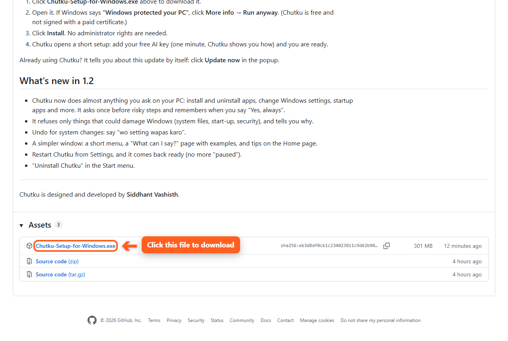
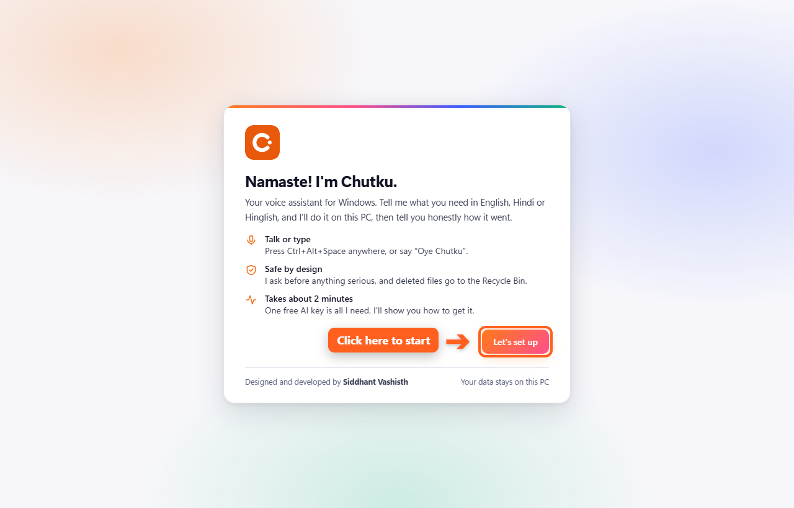
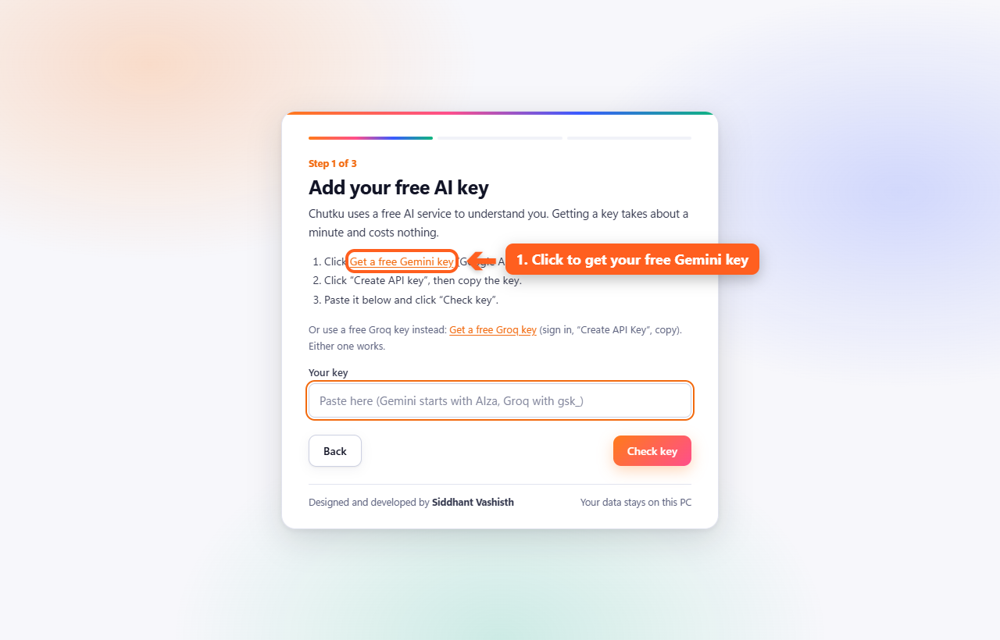
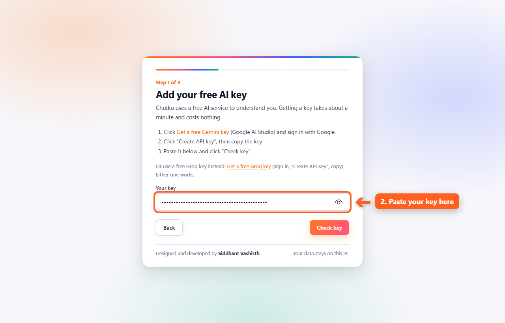
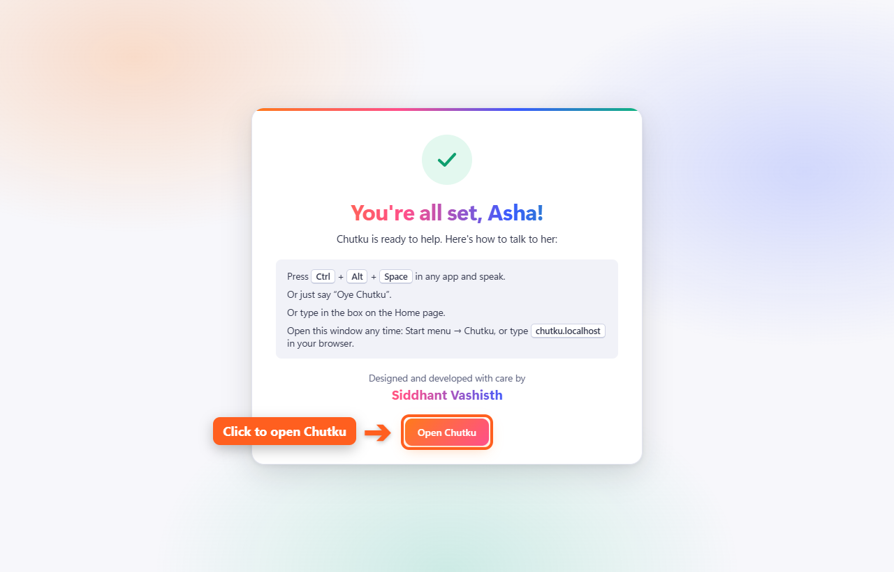
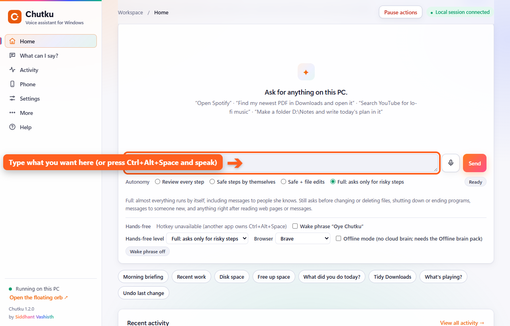
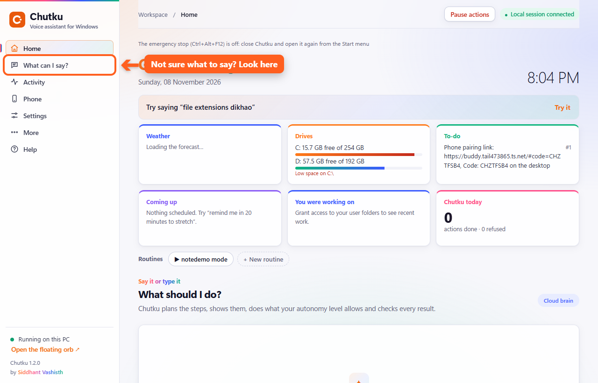

# Chutku: your voice assistant for Windows

**Chutku does things on your PC when you ask.** Say or type what you want in English, Hindi or Hinglish, and she
does it: open apps, find files, play music, change settings, install apps, set reminders, and much more.

Designed and developed by **Siddhant Vashisth**. Free.

> **Only for Windows 10 and 11 (64-bit) computers.** It does not work on Mac, Linux, Android or iPhone.

---

## Install in 6 easy steps

### Step 1: Download the setup file
Open **[the latest release](../../releases/latest)** and click **Chutku-Setup-for-Windows.exe**.

That is the only file you need. Ignore "Source code"; GitHub adds those links to every release.

### Step 2: Open the file you downloaded
Find **Chutku-Setup-for-Windows.exe** in your **Downloads** folder and double-click it.

If Windows shows a blue box saying **"Windows protected your PC"**:
1. Click **More info** (small text under the message).
2. Click **Run anyway**.

This appears because Chutku is free and not signed with a paid certificate. The setup checks itself before
installing anything.

### Step 3: Click Install
Click **Install**, then **Finish**. You don't need to change anything: the defaults are right. No administrator
password is needed.

### Step 4: Start the short setup
Chutku opens by itself. Click **Let's set up**.

### Step 5: Add your free AI key (one minute)
Chutku needs one free key to understand you.

1. Click **Get a free Gemini key**. Google AI Studio opens. Sign in with your Google account.
2. Click **Create API key**, then copy the key.

   (Prefer Groq? Click **Get a free Groq key** just below instead. Either key works.)

3. Come back to Chutku, paste the key in the box (**Ctrl+V**), and click **Check key**.

Chutku checks the key. If something is wrong, it tells you exactly what to do. Then type your name (optional),
click **Continue**, and click **Finish setup**.

### Step 6: You're ready!
Click **Open Chutku**.

---

## How to use Chutku

**Type** what you want in the box and press **Enter**, or press **Ctrl + Alt + Space** in any app and **speak**.
You can also say **"Oye Chutku"**.

Try these:
- "Spotify pe lofi chalao"
- "meri last PDF kholo"
- "Downloads saaf karo"
- "install VLC"
- "file extensions dikhao"
- "kitni jagah bachi hai"
- "remind me in 20 minutes to drink water"

**Not sure what to say?** Click **What can I say?** on the left for examples. Click any example to try it.

**Open Chutku later:** press the Windows key, type **Chutku**, press Enter. Or type **chutku.localhost** in your
browser while Chutku is running.

**Stop everything at once:** press **Ctrl + Alt + F12**.

---

## Safe by design
- **She asks before anything risky** (deleting your files, shutting down, messaging someone new, installing apps).
  Click **Yes, always** and she won't ask again for that exact thing.
- **She never damages Windows.** Requests to delete system files, turn off Defender or the firewall, or format a
  drive are refused, with the reason.
- **Deleted files go to the Recycle Bin**, so you can bring them back. Say "wo setting wapas karo" to undo a
  setting change.
- **Your files stay on your PC.** With the AI key, only your request goes to the AI service.

## Updates
Chutku tells you when a new version is out. Click **Update now** in the small window. Your data is kept.

## Uninstall
Press the Windows key, type **Uninstall Chutku**, press Enter, and click **Yes**. It asks whether to delete your
data too; choose **No** to keep it for later.
(Or: **Settings → Apps → Installed apps → Chutku → Uninstall**.)

If you turned on "Reach this laptop after a restart", click **Turn off** on Chutku's Phone page first.

## Questions
| Question | Answer |
|---|---|
| Is it free? | Yes. The AI key from Google AI Studio (Gemini) or Groq is free too, with a daily limit. |
| It says "quota" or "busy" | The free limit is used up for now. Wait a little, or add a key for the other service in Settings. |
| The shortcut key does nothing | Another app uses Ctrl+Alt+Space. Close it, or restart Chutku (Settings → Restart Chutku). |
| Can I use it for business? | No. Some voice models inside are for non-commercial use only. |
